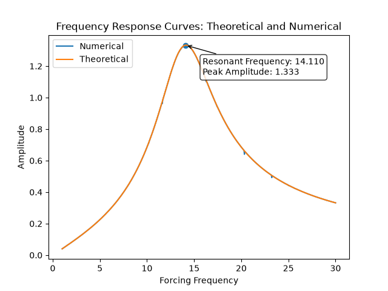

# RLC Circuit Model

## Project Overview

This project models a circuit consisting of a resistor, inductor, and capacitor otherwise known as a RLC circuit. The goal of this project was to simulate a driven RLC circuit and compare the numerical frequency response with the theoretical response. 

## Mathematical Model 

The differential equation that governs this circuit is: 

$$
Lq''(t)+Rq'(t)+\frac{1}{C}q(t)=V(t),
$$

where:

$R$ is the resistance,

$L$ is the inductance,

$C$ is the capacitance,

$V(t)$ is the external voltage source,

$q(t)$ is the charge stored in the capacitor, and

$i(t)=q'(t)$ is the current through the circuit.

This model makes a couple of assumptions. The first being that we assume that each component behaves ideally. Secondly, we assume that the system exhibits lumped-circuit behavior meaning that each component can be represented by a single number. Next, we assume that there are no parasitic effects such as resistors having a tiny inductance, capacitors having small internal resistance and inducatance, and inductors having winding resistance and stray capacitance. Finally, the differential equation was derived assiming that Kirchoff's rule hold exactly. 

## Numerical Approach

In order to apply the solve_ivp solver to numerically approximate a solution to the differential equation, I had to convert the original differential equation into a system of differential equations. Using the fact that the charge and current through the system are enough to describe the system adequately, I rewrote the differential equation into the system of equations:

$$
\frac{dq}{dt}=i
$$

and 

$$
\frac{1}{L}
\left(
V(t)-Ri-\frac{q}{C}
\right).
$$

The steady-state amplitude was estimated using the fact that steady-state charge and current are approximately sinusoidal and so we can estimate the amplitude using the approximation: 

$$
\frac{i_{\max}-i_{\min}}{2},
$$

where $i_{\max}$ and $i_{\min}$ represents the maximum and minimum current values, respectively, within a selected measurement window. In order to get an error between the theoretical and numerical solutions to the differential equation, I had to make sure that I only used values where the transient-state of the approximated solution died off. 

## Results

For a sinusoidal voltage source with amplitude $V_0$ and angular frequency $\omega$, the theoretical steady-state current amplitude is

$$
\frac{V_0}
{\sqrt{
R^2+
\left(
\omega L-\frac{1}{\omega C}
\right)^2
}}.
$$

The quantity $\omega L$ is the inductive reactance, while $1/(\omega C)$ is the capacitive reactance.

The current amplitude is maximized when the two reactances are equal:

$$
\omega L=\frac{1}{\omega C}.
$$

Solving for $\omega$ gives the resonant angular frequency

$$
\omega_0=\frac{1}{\sqrt{LC}}.
$$

The numerical frequency-response curve matched the analytical curve closely. The largest observed error was approximately $0.0213$, occurring near $\omega=20.33\ \text{rad/s}$.

Increasing the number of sampled frequencies reduced the apparent error and caused the numerical frequency-response curve to align more closely with the theoretical curve.

Changing $R$, $L$, and $C$ affected the response in different ways. Changing $L$ or $C$ shifted the resonant frequency, while changing $R$ affected the height and sharpness of the resonance peak. The component values also affected how quickly the transient portion of the solution decayed.

The numerical and theoretical frequency-response curves where $R = 6$, $L = 1$, $C = 0.005$, $V(t) = 8\cos(\omega t)$ are shown below. 

## Reflection & Limitations

The most important numerical challenges was making sure that when plotting the frequency-response curves, I had to make sure that I only included steady-state values. Meaning, the interval of time that I ran the solver for, had to start at a time where most of the transient activity died off. A limitiation of the current model is that if one wanted to simulate realistic circuit component values where capacitance and inductive are very small, the differential equation becomes stiff making the default RK45 method to approximate the solution an ineffective method and one needs to use a method that can handle stiff differential equations. 